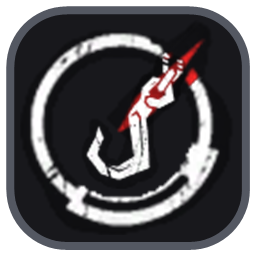
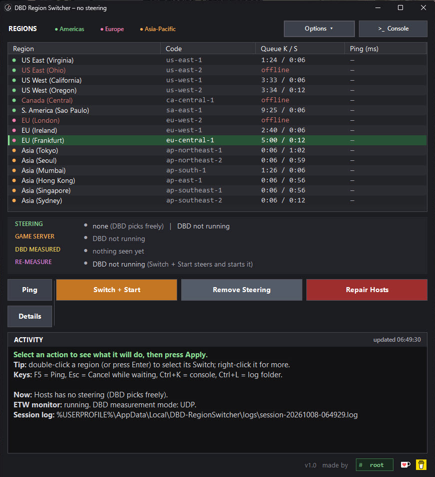

<div align="center">



# DBD Region Switcher

Choose your Dead by Daylight server region and switch it mid-session, no game restart needed.

[](https://github.com/010root/DBD-RegionSwitcher/releases/latest)


[](LICENSE)

**[Download](https://github.com/010root/DBD-RegionSwitcher/releases/latest)** &nbsp;·&nbsp;
[First switch](#your-first-switch) &nbsp;·&nbsp;
[Questions](#questions) &nbsp;·&nbsp;
[How it works](docs/how-it-works.md)



</div>

## What it does

Dead by Daylight picks your region with a quick test: it pings every AWS region it supports to see how fast each one
answers (your latency, in ms), and BHVR's servers place you based on the results. DBD runs this test when it starts,
and again when it reloads after losing its connection, if at least 10 minutes have passed since the last one. Whenever
the tool or this page says DBD "measures", it means this test.

A switch goes like this:

1. A small block in Windows' `hosts` file makes every region except your pick unreachable, so DBD can only choose
   your pick.
2. The tool cuts DBD's connection to its servers until DBD shows its connection error.
3. DBD reloads on its main loading screen and measures again, now with only your pick reachable.

[docs/how-it-works.md](docs/how-it-works.md) explains the details.

## Download

Get `DBD-RegionSwitcher.exe` from the [Releases](https://github.com/010root/DBD-RegionSwitcher/releases/latest) page
and run it. There's nothing to install. It asks for administrator rights (Windows' UAC prompt) when it starts, because
the `hosts` file, the connection cut and the clock option all need them.

> [!NOTE]
> Windows may show "Windows protected your PC" for a new download. Click **More info**, then **Run anyway**.

<details>
<summary><b>Check that your copy is the official build</b></summary>
<br>

Each release lists the file's SHA-256 and is built by GitHub Actions from that version's source. With the [GitHub
CLI](https://cli.github.com), this checks that your copy is that build:

```
gh attestation verify DBD-RegionSwitcher.exe --repo 010root/DBD-RegionSwitcher
```

</details>

## Your first switch

1. Start the tool and accept the UAC prompt.
2. If your DBD isn't the Steam version, or you have it on more than one store, start DBD yourself once while the tool
   is open. The tool remembers which store it ran from and uses that one for Switch + Start / Restart from then on.
3. Optional: press **Ping** (or <kbd>F5</kbd>) to see your connect time to every region.
4. Pick a region in the list. The tool offers the actions that make sense right now: **Switch (no restart)** if DBD
   is running, **Switch + Start** if it isn't.
5. Read the description it shows. It says exactly what will happen, including any wait. Press **Apply**.
6. With Switch (no restart), DBD shows a connection error. That's the tool's doing. Click OK and press a key: DBD
   reloads on its main loading screen and measures again, now with only your pick reachable.
7. The tool then says which regions DBD could reach. Ready up, and once a lobby is found the GAME SERVER line shows
   the region you landed in.

The steering stays until you remove it, so DBD keeps choosing your pick at every launch, with or without the tool
open. If you'd rather it go away by itself, set **Options > Steering lasts** to "until DBD closes".

## Actions

Every action shows what it will do first and only runs when you press **Apply**. The tool waits until you're out of
any lobby, match or end game chat before it cuts or closes anything, so it never drops you from a game.

| Action | What it does |
| --- | --- |
| **Switch (no restart)** | Steers to the picked region and makes DBD re-measure. Shown while DBD is running. |
| **Switch + Restart** | Steers, closes DBD and starts it again through its store (Steam, Epic Games or the Xbox app). |
| **Switch + Start** | The same while DBD isn't running: steers and starts DBD. |
| **Remove Steering** | Deletes only the tool's block from `hosts`. DBD picks freely again from its next measurement. |
| **Repair Hosts** | Replaces the whole `hosts` file with the Windows default. Asks first if that would delete others' entries. |
| **Ping** | Measures this PC's connect time to every region. It ignores the steering, so every region gets a real number. |

DBD only re-measures 10 minutes after its last measurement, so Switch (no restart) waits for that window, or skips it
with the [clock option](#options). Until the tool has seen DBD run, Switch + Start guesses the store, Steam first.

| Key | What it does |
| --- | --- |
| <kbd>F5</kbd> | Ping |
| <kbd>Esc</kbd> | Cancel a Switch that's still waiting |
| <kbd>Ctrl</kbd> + <kbd>K</kbd> | Console |
| <kbd>Ctrl</kbd> + <kbd>L</kbd> | Log folder |

## The window

The four lines above the buttons (hover a line's name for what it means):

| Line | Shows |
| --- | --- |
| **Steering** | The region the `hosts` block steers to, and whether DBD is running (with its process id). |
| **Game server** | The server of your lobby, match or end game chat: its address, packets per second and region. |
| **DBD measured** | DBD's last test of every region: when, and which regions it could reach. |
| **Re-measure** | When DBD will measure again (at most every 10 minutes), which is when a Switch (no restart) can go. |

The game server's region comes from Amazon's published address list. Some addresses are listed there only as GLOBAL;
the region shown then is the one DBD could reach.

The region list can show status and queue times from [deadbyqueue.com](https://deadbyqueue.com), a community site
that isn't run by BHVR. A region listed as offline still answers pings: BHVR scales a region's servers down for a few
hours when few people play there.

**Details** shows a read-only snapshot of everything the tool knows: the monitor's state, DBD's last measurement and
every name DBD looked up. **Console** shows the session log live, and can also show every name DBD looks up.

## Options

| Option | What it does |
| --- | --- |
| **Skip 10-min wait (clock)** | Moves the PC clock ahead right before the cut, just far enough for DBD's 10-minute rule to pass, and puts it back the moment DBD starts measuring. The time comes from the PC's own counter, so it's put back exactly. If DBD doesn't start measuring, the clock goes back after 3 minutes at the latest. |
| **Fix mouse colors (NGENUITY)** | HyperX NGENUITY's lighting stalls when the clock goes back, so the tool restarts its background part afterwards (about a second, no window). If security software blocks that, it opens NGENUITY instead and closes its window after a few seconds. Only matters with the clock option and HyperX gear. |
| **Steering lasts** | Until you remove it (the default), or until DBD closes: then it's removed once DBD has measured with it and closed. A Switch + Restart, or steering written for a DBD you're about to start, keeps it until then. |
| **Region status and queue times** | From deadbyqueue.com, checked every 3 minutes while it's on. |
| **Check for updates** | Once a day, see [Updates](#updates). |

Also in Options: sorting (or click a column), ping bars, keep on top, and what the close button does (ask, close to
the system tray, or quit).

## What it changes on your PC

- **The `hosts` file:** only its own marked block (`# === DBD-RegionSwitcher BEGIN ... END ===`). Everything else in
  the file stays byte for byte. Repair Hosts is the one exception, and it asks first.
- **DBD's network connections,** which it cuts during a switch.
- **The PC clock,** only with the clock option on, for seconds at a time.
- **Its own folder,** `%LOCALAPPDATA%\DBD-RegionSwitcher`, for session logs (kept 60 days) and settings.

It never reads, writes or patches the game's files, and never touches the game's memory. DBD is always started as
your normal Windows user, never with the tool's admin rights.

What it connects to. These are read-only downloads and nothing about you is sent, but like any web request they show
the site your IP address.

| Address | What for | How often |
| --- | --- | --- |
| `ip-ranges.amazonaws.com` | AWS's public address list, to name the game server's region | Weekly |
| `api2.deadbyqueue.com` | Region status and queue times | Every 3 minutes, while that option is on |
| `api.github.com` | The update check | Once a day, while that option is on |
| Each region's AWS endpoint | Ping | When you press Ping |

## Questions

Click a question to open it. If yours isn't answered here or in [docs/how-it-works.md](docs/how-it-works.md), ask in
[Discussions](https://github.com/010root/DBD-RegionSwitcher/discussions).

<details>
<summary><b>Can I get banned for this?</b></summary>
<br>

I can't answer for BHVR. What I can tell you is exactly what the tool does: it edits Windows' `hosts` file, closes
DBD's network connections through Windows' own network functions, and with the clock option moves the PC clock. It
doesn't read or change the game's files or memory and doesn't inject anything into it. Whether choosing your region
this way is allowed is a question for Behaviour Interactive's terms of service. Use it at your own risk.

</details>

<details>
<summary><b>Does it lower my ping?</b></summary>
<br>

No. It only decides which region DBD picks. Your ping to that region is whatever it is, and Ping shows it before you
switch. Picking a region far away gives you a higher ping.

</details>

<details>
<summary><b>Why do I get a connection error in DBD?</b></summary>
<br>

During a Switch (no restart) the tool cuts DBD's connection on purpose: DBD only measures the regions again when it
reloads after a lost connection. Click OK and press a key. With Switch + Restart there's no error, DBD just restarts.

</details>

<details>
<summary><b>Why does a Switch sometimes wait?</b></summary>
<br>

DBD measures at most once every 10 minutes. If its last measurement was less than 10 minutes ago, a Switch (no
restart) waits until then. The Re-measure line shows when that is. Turn on the clock option to skip the wait, or use
Switch + Restart. The tool also waits while you're in a lobby, match or end game chat, so it never cuts you out of a
game.

</details>

<details>
<summary><b>I landed in another region anyway</b></summary>
<br>

If you're in a party, check who's hosting first (see the next question). After each switch the tool tells you what
DBD could reach. If your pick's ping server didn't answer, DBD reports every region as failed and BHVR's server picks
one, usually not yours; the tool warns about this. Try Ping, and if your pick doesn't answer, choose another region.
If DBD could only reach your pick and you still landed elsewhere, the choice was made on BHVR's side. Please open an
[issue](https://github.com/010root/DBD-RegionSwitcher/issues) with the session log.

</details>

<details>
<summary><b>Does it work when I play with friends?</b></summary>
<br>

The party's host decides the region. DBD places the whole party by the host's measurement, so if the host doesn't use
the tool, DBD places them as usual and you follow, regardless of your own steering. To play on a region together, the
host is the one who should switch.

</details>

<details>
<summary><b>Does it work with a VPN?</b></summary>
<br>

Yes, I've played with a VPN on several times without problems. DBD looks the region names up through Windows, and
Windows checks the `hosts` file before it asks any DNS server, so the VPN doesn't get around the steering. The tool
doesn't touch the firewall either.

</details>

<details>
<summary><b>Do I need to keep the tool open?</b></summary>
<br>

Not for the steering itself: it's in `hosts` and DBD uses it at every launch until you remove it. The tool has to be
open for a Switch (no restart), for temporary steering to be removed when DBD closes, and for the readouts. Closing it
to the system tray keeps it running out of the way.

</details>

<details>
<summary><b>Does it affect other games or websites?</b></summary>
<br>

The block covers only the AWS GameLift names DBD measures regions with (`gamelift-ping.<region>.api.aws` and
`gamelift.<region>.amazonaws.com`), for every region except your pick. Websites and other AWS services aren't
affected. Another game that measures the same GameLift names would also only reach your pick while the block is
there. If that's a problem, use temporary steering or Remove Steering when you're done.

</details>

<details>
<summary><b>Is the clock option safe?</b></summary>
<br>

It moves the Windows clock ahead by the time left until DBD's 10-minute window opens, plus 15 seconds. That's
normally a little over 10 minutes at most, and the tool never goes more than an hour. It puts the clock back the moment
DBD starts measuring after its reload, and after 3 minutes at the latest. Closing the tool also puts it back. If the
tool is killed or the PC loses power while the clock is ahead, the tool notices at its next start and offers to sync
the clock with Windows' time server. Programs that watch the clock can notice the jump; HyperX NGENUITY is the one the
tool knows about and handles.

</details>

<details>
<summary><b>My antivirus says the .exe is a threat</b></summary>
<br>

The .exe isn't code-signed, runs PowerShell inside itself, and changes the `hosts` file with admin rights. Some
malware does those things too, so an antivirus may flag it on that pattern alone. You can check that your copy is the
one GitHub built from this source (see [Download](#download)), read the source, or build it yourself (see
[Building](#building)).

</details>

<details>
<summary><b>My antivirus blocks the hosts change</b></summary>
<br>

Some antivirus programs protect the `hosts` file and refuse the write, even from admin programs. The tool tells you
when that happens. Pausing the protection, or marking the tool as trusted in the antivirus' settings, lets the write
through. A plain scan exclusion may not be enough.

</details>

<details>
<summary><b>Does it work on Steam Deck, Mac, Linux or consoles?</b></summary>
<br>

No. It needs Windows 10 or 11, because it changes the PC's own `hosts` file and reads DBD's network activity through
Windows' event tracing. It can't change the region of a console.

</details>

<details>
<summary><b>What's in the session log? Is it safe to share?</b></summary>
<br>

The log records what the tool did and what DBD measured: region names, server addresses and times. Paths inside your
user folder are written as `%USERPROFILE%`, so your Windows user name doesn't appear. It's a plain text file, so you
can read it before you attach it anywhere.

</details>

## Updates

Once a day the tool asks GitHub whether a newer version is out, and the bottom of the window says so. Click it for the
download page. Nothing is downloaded or installed by itself. **Options > Check for updates** turns this off.

## Reporting a problem

For a question, use [Discussions](https://github.com/010root/DBD-RegionSwitcher/discussions). For something that
doesn't work, open an [issue](https://github.com/010root/DBD-RegionSwitcher/issues) and attach the session log from
when it happened (**Options > Open log folder**, or <kbd>Ctrl</kbd> + <kbd>L</kbd>). Logs are named by the date and
time the tool was started.

## Removing it

> [!WARNING]
> Press **Remove Steering** first (or use temporary steering). Otherwise DBD stays on the last region you picked after
> the tool is gone.

Then delete the `.exe` and the `%LOCALAPPDATA%\DBD-RegionSwitcher` folder.

## Support

If the tool is useful to you, you can support it here. The two icons at the bottom right of the window open the same
pages.

[](https://ko-fi.com/010root)
[](https://buymeacoffee.com/010root)

## For developers

### Building

The tool is PowerShell 5.1 with some embedded C#, built into a single `.exe` that runs it in-process. No installs are
needed: Windows' own .NET Framework compiler builds it.

```
powershell -ExecutionPolicy Bypass -File tools\build.ps1 -Exe
```

| Path | What it is |
| --- | --- |
| `src\main\*.ps1` | The tool, in order |
| `src\native\*.cs` | The C# parts |
| `src\icon-art.png`, `src\logo-kofi.png`, `src\logo-bmc.png` | The icon and the support links' logos |
| `tools\build.ps1` | Joins them into `tool\DBD-RegionSwitcher.ps1`, the single script the `.exe` embeds and the tests read |
| `tools\build-exe.ps1` | Compiles `DBD-RegionSwitcher.exe` (`tools\exe\Launcher.cs`) |

`tool\DBD-RegionSwitcher.ps1` is a build output and isn't kept in the repository: edit `src\`, then build.

### Releasing

`.github/workflows/release.yml` builds the `.exe` on GitHub's Windows machine when a version tag is pushed
(`git tag v1.0`, `git push origin v1.0`; the tag must match `$ToolVersion`). It runs the checks that need no game,
then creates a draft release with the `.exe`, its SHA-256, a build attestation and the CHANGELOG section. Publish the
draft by hand once it looks right. **Actions > Release > Run workflow** does a dry run (the `.exe` is kept as a run
artifact, no release).

### Tests

Build first, then run as administrator:

```
powershell -ExecutionPolicy Bypass -File verify\run-elevated.ps1
```

It runs every test suite and a smoke run of the built `.exe` (driven by `verify\hooks\smoke.ps1`). The tests never
write the real `hosts` file and never touch DBD. Results: `verify\work\elevated-results.txt`. The test windows keep
their logs and settings in `%LOCALAPPDATA%\DBD-RegionSwitcher-tests`, away from your own.

- `verify\ui-check.ps1` (no admin needed) runs a copy of the tool driven by `verify\hooks\ui.ps1`: it films the window
  from another thread to catch flicker, and checks the layout, text cursors and the switch logic against a copy of
  `hosts`. `-Light` runs the copy as if Windows were set to light mode (for that process only).
- Test windows open on display 2 (`DBDRS_TEST_SCREEN=DISPLAY3` picks another) and get their keys sent straight to
  them, so whatever runs on the main screen keeps its focus. `-Toasts` also shows the two tray notifications (Windows
  shows them on the main screen).

## Credits

The icon combines two of Dead by Daylight's own UI icons. That art belongs to Behaviour Interactive; this project's
licence doesn't cover it. The Ko-fi and Buy Me a Coffee logos belong to those companies (from their brand assets) and
aren't covered either. Dead by Daylight is a trademark of Behaviour Interactive Inc. This project isn't affiliated
with or endorsed by Behaviour Interactive.

## Licence

Copyright (C) 2026 root.

GNU General Public License v3.0, see [LICENSE](LICENSE). Copies and changed versions of the tool, free or paid, must
keep this copyright notice and come with their full source code under the same licence. The icon art and the two
logos (above) aren't covered.
